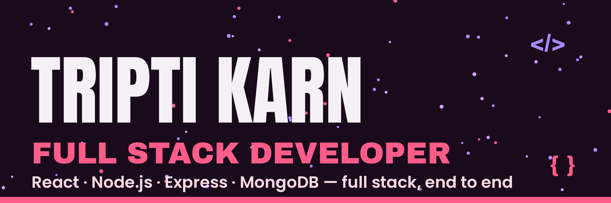
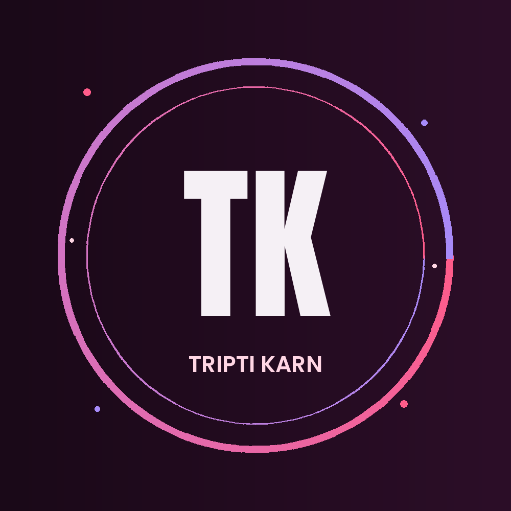
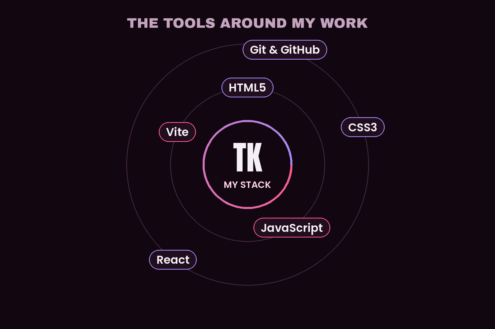
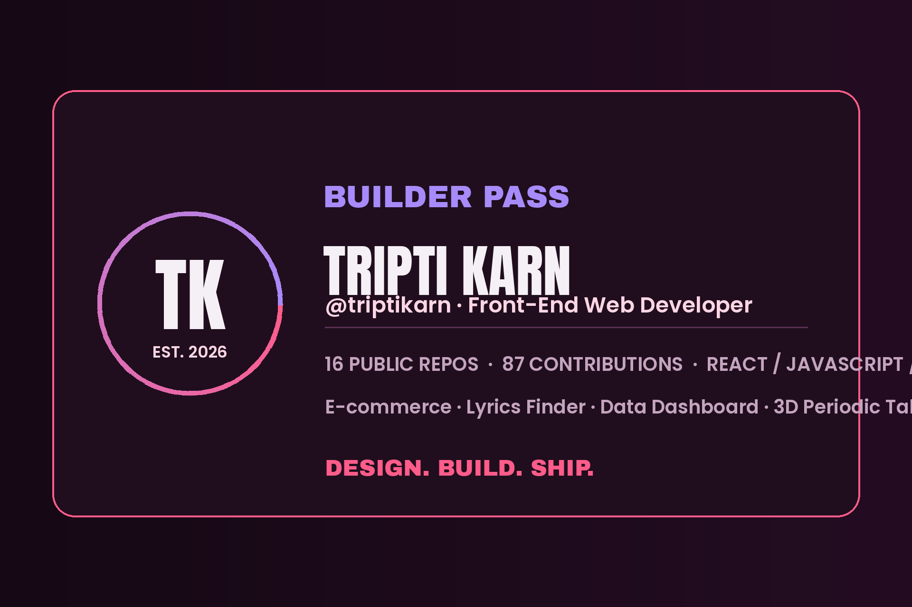

### TRIPTI KARN

**Full Stack Developer · Frontend & Backend · Node.js · Express · MongoDB · JavaScript**

I build interfaces that feel alive — responsive pages, interactive dashboards and small web apps with HTML, CSS, JavaScript and React. Every project here started as a blank file and ended as something you can click, search, play and explore.

💻 [GitHub](https://github.com/triptikarn) · 💼 [LinkedIn](https://www.linkedin.com/in/tripti-karn-39233333b/) · ✉️ triptikarn6@gmail.com

---

### 01 / FROM THOUGHT TO THING

```
$ build()

sketch → code → refine → ship
```

**THINK** — Picture the screen first: layout, colours, and how it should feel on a phone.
**EXECUTE** — Build it with clean, semantic HTML, modern CSS and vanilla JavaScript or React.
**BUILD** — Polish the details — hover states, transitions, empty states — until it feels finished.

- Responsive, mobile-first layouts
- React components & state (useState, routing)
- JavaScript interactivity & API data
- CSS animation & visual design

### 02 / LIFE OUTSIDE THE COMMIT


1. **Learning in public** — 87 contributions in the last year, one small project at a time.
2. **Exploring APIs** — lyrics search, QR generation, text-to-speech: tiny apps that talk to the real world.
3. **Designing as I code** — gradients, glass cards and playful micro-interactions are my signature.

**BELIEF** — A page isn't done when it works. It's done when it feels good to use.

---


---

## 03 / MY ONLINE ROOM



**Languages**

  

**Frameworks & Tools**

    

**Backend**

    

---

## THINGS I'VE BUILT

| Project | What it does | Focus |
| --- | --- | --- |
| [E-commerce-website-](https://github.com/triptikarn/E-commerce-website-) | A modern e-commerce web application built with React JS | React · UI |
| [lyrics-finder](https://github.com/triptikarn/lyrics-finder) | Search songs and view lyrics, with search history — React + Vite | React · API |
| [Interactive--visualization-dashboard-](https://github.com/triptikarn/Interactive--visualization-dashboard-) | Data dashboard with pie, line and bar charts for complex metrics | JavaScript · Charts |
| [Periodic-Table-](https://github.com/triptikarn/Periodic-Table-) | Interactive 3D periodic table | JavaScript · 3D |
| [QR-code-generator](https://github.com/triptikarn/QR-code-generator) | Create QR codes instantly in the browser | HTML · CSS · JS |
| [simple-text-to-speech](https://github.com/triptikarn/simple-text-to-speech) | Converts text into speech with a clean, minimal interface | Web Speech API |

**More experiments:** [Lamp--login-UI](https://github.com/triptikarn/Lamp--login-UI) (a login page with a working lamp), [Modern-Hero-carousel](https://github.com/triptikarn/Modern-Hero-carousel), [Routing-useState-cards](https://github.com/triptikarn/Routing-useState-cards), [js-learning](https://github.com/triptikarn/js-learning) and a full-stack MERN daily planner in progress.

---

## REAL WORK. REAL PROGRESS.



| 16 | 87 | 06 |
| --- | --- | --- |
| **PUBLIC PROJECTS** | **CONTRIBUTIONS (LAST YEAR)** | **FEATURED BUILDS** |

**CORE CRAFT**

```
HTML & CSS          ████████████████████
JavaScript          ██████████████████░░
React               ████████████████░░░░
Responsive design   ████████████████████
```

*Bars mark focus areas, not scores.*

---

## LET'S CONNECT.

### BUILD SOMETHING BEAUTIFUL.

|  |  |
| --- | --- |
| 💻 GitHub | [@triptikarn](https://github.com/triptikarn) |
| 💼 LinkedIn | [Tripti Karn](https://www.linkedin.com/in/tripti-karn-39233333b/) |
| ✉️ Email | triptikarn6@gmail.com |
| 🌐 Portfolio | [triptikarn.github.io/portfolio](https://triptikarn.github.io/portfolio/) |

---

*Designing, building and shipping — one interface at a time.*
